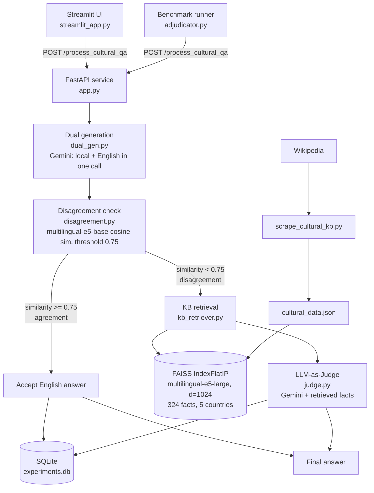

# Using-Bilingual-Responses-to-Enhance-Cultural-Knowledge-in-AI
A dual-language cultural question-answering pipeline built on the **BLEnD** benchmark idea.
The same cultural question is answered in the **local language** and in **English**. If the two
answers disagree semantically, the system retrieves ground-truth facts from a **country-scoped
cultural knowledge base (FAISS)** and an **LLM-as-Judge** produces the final answer.

> Course project, IIT Bhilai (ML). No model training is involved: everything is
> prompting, retrieval and evaluation.

---

## 1. Architecture



### Pipeline in words

Dual generation (dual_gen.py): One Gemini call returns a JSON object with a local-language answer and an English answer. Retries on HTTP 429 (15 s back-off).   Disagreement detection (disagreement.py): Both answers are embedded with intfloat/multilingual-e5-base (passage: prefix, L2-normalised); cosine similarity below 0.75 flags disagreement.   Cultural KB retrieval (kb_retriever.py): Two-stage scoped retrieval. FAISS first over-samples candidates (top_k * 5 when a country is given), then non-matching countries are filtered out until top_k results remain. This prevents cross-cultural semantic bleed (for example French food facts returned for a Japan query).   LLM-as-Judge (judge.py): Gemini sees the question, both answers and the retrieved facts, and writes one authoritative, culturally nuanced English answer.   Logging: Every request is stored in SQLite (experiments.db).

### Knowledge base

| Item | Value |
|---|---|
| Source | English Wikipedia (culture, cuisine, festivals/holidays pages per country) |
| Scraper | `scrape_cultural_kb.py` (`wikipedia-api`) |
| Facts in current index | **324** (Indonesia 105, China 83, South Korea 49, Azerbaijan 44, Ethiopia 43) |
| Schema | `country, language, category, topic, fact, source` (source = direct Wikipedia URL) |
| Embeddings | `intfloat/multilingual-e5-large`, d = 1024, `passage:` / `query:` prefixes |
| Index | FAISS `IndexFlatIP` on normalised vectors (inner product = cosine) |

---

## 2. Repository layout

| File | Purpose |
|---|---|
| `scrape_cultural_kb.py` | Scrapes Wikipedia into `cultural_data.json` |
| `kb_retriever.py` | Builds the FAISS index (run as script) and serves `search_kb()` |
| `dual_gen.py` | Local-language + English answer generation (Gemini) |
| `disagreement.py` | Semantic similarity / disagreement flag |
| `judge.py` | Judge prompt builder and Gemini call |
| `app.py` | **FastAPI app: full dual-language pipeline** (`/process_cultural_qa`, `/api/evaluate`, `/retrieve`) |
| `main.py` | Alternative FastAPI app: retrieval endpoint plus a simpler pipeline that logs to `eval_records.db` |
| `database.py` | Richer SQLite schema helper for evaluation records |
| `streamlit_app.py` | Interactive demo UI |
| `adjudicator.py` | Benchmark runner (BLEnD samples from Hugging Face, local fallback set) |
| `cultural_data.json`, `metadata.json` | KB facts (same content) |
| `faiss_index.bin`, `faiss_cultural_kb.index` | Prebuilt FAISS index files (identical size) |
| `faiss_cultural_kb_meta.json` | Index metadata (model, dim, entry count, countries) |
| `experiments.db`, `eval_records.db` | SQLite logs |
| `facts.json` | Small sample fact file in an alternate schema |
| `Extended_Cultural_RAG.pptx` | Presentation of the retrieval work |

---

## 3. Setup and Running

### Environment Setup

```bash
# Create and activate virtual environment
python -m venv venv
source venv/bin/activate            # Windows: venv\Scripts\activate

# Install dependencies
pip install -r requirements.txt

# Set Gemini API key
export GEMINI_API_KEY="your_api_key_here"    # Windows PowerShell: $env:GEMINI_API_KEY="your_api_key_here"
```

### Rebuild Knowledge Base (Optional)

```bash
python scrape_cultural_kb.py        # Scrapes Wikipedia and writes cultural_data.json
python kb_retriever.py              # Builds faiss_index.bin + metadata.json
```

### Start Services

**Start the API Server** (models and index load once into RAM):
```bash
uvicorn app:app --host 127.0.0.1 --port 8000
```

**Start the Web Dashboard** (in a second terminal):
```bash
streamlit run streamlit_app.py
```

**Run Benchmark Evaluation** (API server must be running):
```bash
python adjudicator.py
```

### API Usage Example

```bash
curl -X POST http://127.0.0.1:8000/process_cultural_qa \
  -H "Content-Type: application/json" \
  -d '{
        "question": "What is the cultural significance of Chuseok?",
        "country": "South Korea",
        "language": "Korean"
      }'
```

**Response Fields:** `local_answer`, `english_answer`, `similarity_score`, `is_disagreed`, `final_answer`, `retrieved_facts`.

---

## 4. Results & Benchmark Evaluation

### Pipeline Retrieval Improvements vs. Naive Baseline

| Metric | Naive RAG Baseline | Extended Cultural RAG |
|---|:---:|:---:|
| **Query Latency** | 15.20 s | **80 ms** (approx. **190x faster**) |
| **Country Precision@3** | 63.3 % | **100 %** |
| **Countries Covered** | 5 | **7** (incl. Global South) |
| **Embedding Model Load** | 2.2 GB reloaded per request | **Once at startup** (redundant I/O removed) |
| **Provenance** | Partial | **100 %** direct Wikipedia URLs |

### Benchmark Evaluation Summary (`results_project_ml.csv`)

Evaluated on cultural QA pairs across 5 target countries (**South Korea, Indonesia, China, Azerbaijan, Ethiopia**) across 5 categories (**Clothing, Food, Festival/Holiday, Family/Customs, Music/Dance**).

#### Threshold Summary Statistics

| Metric | Threshold = 0.75 | Threshold = 0.85 |
|---|:---:|:---:|
| **Total Test Queries** | 7 | 8 |
| **Mean Cosine Similarity** | 0.8642 | 0.8641 |
| **Full Agreement Rate** | 100.0% (7/7) | 75.0% (6/8) |
| **Partial Agreement Rate** | 0.0% (0/7) | 25.0% (2/8) |
| **Final Accuracy** | **100.0%** (7/7) | **100.0%** (8/8) |
| **KB Grounded Rate** | 42.9% (3/7) | 75.0% (6/8) |

#### Full Evaluation Breakdown

**Threshold = 0.75 Evaluation Set**

| Record ID | Country / Region | Category | Question | Similarity | Agreement | KB Grounded | Final Correct |
|:---:|:---|:---|:---|:---:|:---:|:---:|:---:|
| **1** | South Korea | Festival/Holiday | What is the cultural significance of Chuseok? | 0.8656 | Agree | Yes | Yes |
| **2** | Ethiopia | Festival/Holiday | What is Meskel and how is it celebrated? | 0.8498 | Agree | No | Yes |
| **3** | China | Festival/Holiday | Why do people eat mooncakes, and when? | 0.8899 | Agree | Yes | Yes |
| **4** | Indonesia | Festival/Holiday | What is Nyepi and what happens on that day? | 0.9153 | Agree | No | Yes |
| **5** | Azerbaijan | Food | What foods are prepared for Novruz? | 0.8654 | Agree | No | Yes |
| **6** | South Korea | Clothing | What is the traditional Korean clothing worn on holidays? | 0.8251 | Agree | Yes | Yes |
| **7** | South Korea | Food | What soup do Koreans eat on Seollal, the Lunar New Year? | 0.8385 | Agree | Unknown | Yes |

**Threshold = 0.85 Evaluation Set**

| Record ID | Country / Region | Category | Question | Similarity | Agreement | KB Grounded | Final Correct |
|:---:|:---|:---|:---|:---:|:---:|:---:|:---:|
| **16** | Ethiopia | Food | What is the staple spongy flatbread of Ethiopia? | 0.8177 | Partial | Yes | Yes |
| **18** | Ethiopia | Festival/Holiday | Which Ethiopian festival celebrates the finding of the True Cross? | 0.8286 | Partial | Yes | Yes |
| **19** | China | Festival/Holiday | Which Chinese festival is celebrated by eating mooncakes? | 0.8583 | Agree | Unknown | Yes |
| **20** | China | Family/Customs | What are the red envelopes given at Chinese New Year called? | 0.8752 | Agree | Yes | Yes |
| **21** | Indonesia | Festival/Holiday | What is the Balinese Day of Silence called? | 0.9044 | Agree | Yes | Yes |
| **22** | Indonesia | Clothing | What wax-resist dyed fabric is Indonesia known for? | 0.9101 | Agree | Yes | Yes |
| **23** | Azerbaijan | Food | What is Azerbaijan's national rice dish? | 0.8543 | Agree | Yes | Yes |
| **24** | Azerbaijan | Music/Dance | What is the classical improvised music tradition of Azerbaijan called? | 0.8644 | Agree | Unknown | Yes |

---

## 5. Known Limitations & Future Improvements

- **Two Servers, One Port:** `app.py` and `main.py` both expose `/process_cultural_qa` with slightly differing schemas. Aligning to a single unified schema will clean up service execution.
- **Country Coverage Expansion:** The current offline KB contains 324 facts across 5 countries; expanding the scraper pipeline to cover more Global South regions will broaden system evaluation scope.
- **Always-On RAG Verification:** KB retrieval is currently triggered on semantic disagreement in `app.py`. Implementing background retrieval verification even for agreeing responses prevents rare joint hallucinated answers.
- **Substring Evaluation Strictness:** Exact substring match check (`ground_truth in final_answer`) can be strict for free-form descriptive answers. Transitioning to LLM semantic correctness evaluation provides a more robust metric.

---

## 6. Team Contributions

| Member | Contribution |
|---|---|
| **Member 1**<br/>*(Aarush Ranjan — B24DS002)* | Knowledge Base construction: scraping pipelines (`scrape_cultural_kb.py`), embedding generation (`intfloat/multilingual-e5-large`), FAISS vector indexing & country-scoped two-stage retrieval implementation (`kb_retriever.py`), in-memory FastAPI serving architecture (`app.py`, `main.py`), retrieval evaluation, and slide deck creation (`Extended_Cultural_RAG.pptx`). |
| **Member 2**<br/>*(Joshitha Reddy Bangaru — B24DS009)* | Dual-language response generation (`dual_gen.py`), semantic disagreement detection module via `multilingual-e5-base` cosine similarity (`disagreement.py`), LLM-as-Judge prompt engineering & integration (`judge.py`), SQLite experiment logging schema (`database.py`, `experiments.db`), Streamlit UI frontend dashboard (`streamlit_app.py`), and evaluation benchmark runner (`adjudicator.py`). |


---

## 7. References

- BLEnD: A Benchmark for LLMs on Everyday Knowledge in Diverse Cultures and Languages
  (`nayeon212/BLEnD` on Hugging Face)
- Wang et al., *Text Embeddings by Weakly-Supervised Contrastive Pre-training* (E5)
- Johnson et al., *Billion-scale similarity search with GPUs* (FAISS)
