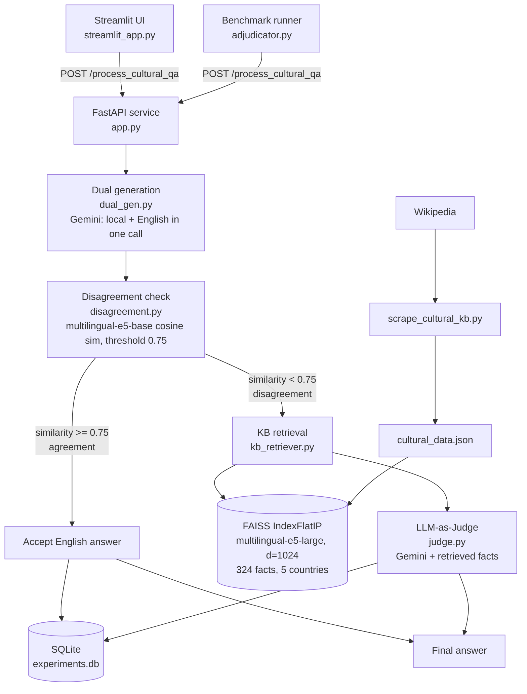

# Using-Bilingual-Responses-to-Enhance-Cultural-Knowledge-in-AI
A dual-language cultural question-answering pipeline built on the **BLEnD** benchmark idea.
The same cultural question is answered in the **local language** and in **English**. If the two
answers disagree semantically, the system retrieves ground-truth facts from a **country-scoped
cultural knowledge base (FAISS)** and an **LLM-as-Judge** produces the final answer.

> Course project, IIT Bhilai (ML). No model training is involved: everything is
> prompting, retrieval and evaluation.

---

## 1. Architecture



### Pipeline in words

Dual generation (dual_gen.py): One Gemini call returns a JSON object with a local-language answer and an English answer. Retries on HTTP 429 (15 s back-off).   Disagreement detection (disagreement.py): Both answers are embedded with intfloat/multilingual-e5-base (passage: prefix, L2-normalised); cosine similarity below 0.75 flags disagreement.   Cultural KB retrieval (kb_retriever.py): Two-stage scoped retrieval. FAISS first over-samples candidates (top_k * 5 when a country is given), then non-matching countries are filtered out until top_k results remain. This prevents cross-cultural semantic bleed (for example French food facts returned for a Japan query).   LLM-as-Judge (judge.py): Gemini sees the question, both answers and the retrieved facts, and writes one authoritative, culturally nuanced English answer.   Logging: Every request is stored in SQLite (experiments.db).

### Knowledge base

| Item | Value |
|---|---|
| Source | English Wikipedia (culture, cuisine, festivals/holidays pages per country) |
| Scraper | `scrape_cultural_kb.py` (`wikipedia-api`) |
| Facts in current index | **324** (Indonesia 105, China 83, South Korea 49, Azerbaijan 44, Ethiopia 43) |
| Schema | `country, language, category, topic, fact, source` (source = direct Wikipedia URL) |
| Embeddings | `intfloat/multilingual-e5-large`, d = 1024, `passage:` / `query:` prefixes |
| Index | FAISS `IndexFlatIP` on normalised vectors (inner product = cosine) |

---

## 2. Repository layout

| File | Purpose |
|---|---|
| `scrape_cultural_kb.py` | Scrapes Wikipedia into `cultural_data.json` |
| `kb_retriever.py` | Builds the FAISS index (run as script) and serves `search_kb()` |
| `dual_gen.py` | Local-language + English answer generation (Gemini) |
| `disagreement.py` | Semantic similarity / disagreement flag |
| `judge.py` | Judge prompt builder and Gemini call |
| `app.py` | **FastAPI app: full dual-language pipeline** (`/process_cultural_qa`, `/api/evaluate`, `/retrieve`) |
| `main.py` | Alternative FastAPI app: retrieval endpoint plus a simpler pipeline that logs to `eval_records.db` |
| `database.py` | Richer SQLite schema helper for evaluation records |
| `streamlit_app.py` | Interactive demo UI |
| `adjudicator.py` | Benchmark runner (BLEnD samples from Hugging Face, local fallback set) |
| `cultural_data.json`, `metadata.json` | KB facts (same content) |
| `faiss_index.bin`, `faiss_cultural_kb.index` | Prebuilt FAISS index files (identical size) |
| `faiss_cultural_kb_meta.json` | Index metadata (model, dim, entry count, countries) |
| `experiments.db`, `eval_records.db` | SQLite logs |
| `facts.json` | Small sample fact file in an alternate schema |
| `Extended_Cultural_RAG.pptx` | Presentation of the retrieval work |

---

## 3. Setup and running

```bash
python -m venv venv
source venv/bin/activate            # Windows: venv\Scripts\activate
pip install -r requirements.txt

export GEMINI_API_KEY="your_key"    # Windows PowerShell: $env:GEMINI_API_KEY="your_key"
```

**rebuild the knowledge base**

```bash
python scrape_cultural_kb.py        # writes cultural_data.json
python kb_retriever.py              # writes faiss_index.bin + metadata.json
```

**Start the API** (models and index load once, then stay in memory)

```bash
uvicorn app:app --host 127.0.0.1 --port 8000
```

**Start the UI** (second terminal)

```bash
streamlit run streamlit_app.py
```

**Run the benchmark** (API must be running)

```bash
python adjudicator.py
```

### API example

```bash
curl -X POST http://127.0.0.1:8000/process_cultural_qa \
  -H "Content-Type: application/json" \
  -d '{"question":"What is the cultural significance of Chuseok?","country":"South Korea","language":"Korean"}'
```

Response fields: `local_answer`, `english_answer`, `similarity_score`, `is_disagreed`,
`final_answer`, `retrieved_facts`.

---

## 4. Results

### Extended Cultural RAG vs. naive RAG baseline (retrieval module)


| Metric | Naive RAG | Extended Cultural RAG |
|---|---|---|
| Query latency | 15.20 s | **80 ms** (about **190x faster**) |
| Country Precision@3 | 63.3 % | **100 %** |
| Countries covered | 5 | 7 (incl. Global South) |
| Embedding-model load | 2.2 GB reloaded per request | Once at startup (redundant I/O removed) |
| Provenance | Partial | 100 % direct Wikipedia URLs |

Why it improved:
- **Singleton model and index in RAM**: no per-request reload, so no cold-start timeouts.
- **Scoped two-stage retrieval**: dense recall first, then an exact country filter.


## 5. Known limitations and things to fix before submission

- **Two servers, one port.** `app.py` and `main.py` both expose `/process_cultural_qa` with
  *different* request/response schemas. The Streamlit UI expects `app.py`'s schema;
  `adjudicator.py` sends `question_id` / `ground_truth` and reads `disagreement_flag`, which only
  `main.py` returns. Pick one and align the other callers.
- **Country coverage mismatch.** The shipped KB has 5 countries (South Korea, Ethiopia, China,
  Indonesia, Azerbaijan); the presentation reports 7 (Japan, Brazil, France, Egypt, South Korea,
  India, Ethiopia) and `adjudicator.py` targets 8. Rebuild the KB with a single consistent list.
- **KB retrieval happens only on disagreement** in `app.py`, so agreeing-but-wrong answers are
  accepted unchecked.
- **Judge-prompt/field mismatches.** `judge.py` reads `item.get("text")`, but KB entries store the
  text under `fact`, so the judge may receive empty facts. `main.py` has the same issue.
- **Correctness check is substring-based** (`ground_truth in final_answer`), which is strict for
  free-form answers.
- The logged runs in `experiments.db` are API-error rows from retired model names; `eval_records.db`
  is empty, so no end-to-end numbers exist yet.
- `google-generativeai` model name is set to `gemini-3.8-flash` in `dual_gen.py` and `judge.py`.
  Change it in one place per file if your key does not support it.

---

## 6. Team contributions

> Fill in names and adjust to what actually happened.

| Member | Contribution |
|---|---|
| _Member 1 (Aarush Ranjan, B24DS002)_ |Knowledge Base construction: scraping pipelines, embedding generation, FAISS vector indexing, scoped two-stage retrieval implementation, in-memory FastAPI serving architecture, retrieval evaluation, and slide deck creation|
| _Member 2 (Joshiitha Reddy Bangaru, B24DS009 )_ | Dual-language response generation, semantic disagreement detection module, LLM-as-Judge prompt engineering & integration, SQLite experiment logging, Streamlit UI frontend dashboard, and adjudicator.py |

---

## 7. References

- BLEnD: A Benchmark for LLMs on Everyday Knowledge in Diverse Cultures and Languages
  (`nayeon212/BLEnD` on Hugging Face)
- Wang et al., *Text Embeddings by Weakly-Supervised Contrastive Pre-training* (E5)
- Johnson et al., *Billion-scale similarity search with GPUs* (FAISS)
